  

  
  
  

---

### 👋 About me

I'm a **Software Engineer** with 3.5 years of experience building backend services and full-stack products, now focused on **AI engineering** — agentic systems, RAG pipelines, and putting LLMs into software that has to work reliably in production.

- 🏦 **Previously:** enterprise Java / Spring Boot work for **Citi** and **Zensar Technologies**
- 🤖 **Now building:** multi-agent tools, computer-use automation, and LLM-powered products
- 🎓 **M.S. Computer Science**, University of North Texas · **B.Tech CS**, VIT Chennai
- 📄 Co-author of [*Beyond Sight: Empowering Visually Impaired Users with Audible Graphs*](https://doi.org/10.1145/3677846.3677864), **ACM W4A '24**
- 💬 Ask me about: Spring Boot microservices, LangGraph agents, record-and-replay browser automation

  

---

### 🧭 How I build

Common rules across my projects:

| | Principle | Where it shows up |
|:-:|---|---|
| 🎥 | **LLMs explore, code executes.** Use the model once to work out a workflow, then run it deterministically, so it's cheap, fast, and auditable. | [Computer-Use Automation](https://github.com/santosh1664/computer-use-automation-system) records a capability artifact and replays it with zero LLM calls |
| 🧾 | **Never invent.** AI output must be backed by real data or get rejected. | [Rejekt.ai](https://github.com/santosh1664/rejekt-ai) guards reject any resume rewrite the original doesn't support, and list gaps instead |
| ✅ | **Approve before write.** Humans sign off, then the system re-checks safety right before acting. | [Bellhaven Sync](https://github.com/santosh1664/bellhaven-sync) only applies approved CRM changes and re-verifies before every write |
| 🛑 | **Paper first, guardrails always.** Risky automation starts in simulation behind hard limits. | [Angel One Skills](https://github.com/santosh1664/Angle-agent-skills) paper-trade by default; a risk gate blocks any order over the limits |

---

### 🚀 Featured work

<table>
  <tr>
    <td width="50%" valign="top">
      <h4>🎯 <a href="https://github.com/santosh1664/rejekt-ai">Rejekt.ai</a></h4>
      
Job-search engine that scans tens of thousands of company career pages (Greenhouse, Lever, Ashby, Workday…), ranks every posting against your resume, and tailors it with a <b>local LLM</b> — guarded so it never invents experience. Includes ATS scoring, PDF rendering, and opt-in auto-apply lanes.

      
      
      
      
    </td>
    <td width="50%" valign="top">
      <h4>📈 <a href="https://github.com/santosh1664/Angle-agent-skills">Angel One Agent Skills</a></h4>
      
11 Claude agent skills for NSE intraday trading via Angel One SmartAPI: market scanner, filings &amp; insider tracker, entry timer, exit planner, a 10,000-run Monte Carlo "time machine", position sizing, a hard risk gate, and a paper-first broker. Installs as a Claude Code plugin.

      
      
      
    </td>
  </tr>
  <tr>
    <td width="50%" valign="top">
      <h4>🖱️ <a href="https://github.com/santosh1664/computer-use-automation-system">Computer-Use Automation System</a></h4>
      
An LLM explores a legacy banking UI once and records the workflow as a typed, versioned <b>capability artifact</b>; production then replays it deterministically with no LLM in the loop — multi-locator fallback, safety classes, and human-in-the-loop escalation. (<a href="https://github.com/santosh1664/interface-ai-assignment">Python version</a>)

      
      
      
    </td>
    <td width="50%" valign="top">
      <h4>🔁 <a href="https://github.com/santosh1664/bellhaven-sync">Bellhaven CRM Reconciliation</a></h4>
      
Scrapes public facility pages, matches them to CRM accounts with explainable, weighted scoring (address &gt; name), and writes back <b>only reviewer-approved changes</b> — re-checking safety rules right before every write and verifying after.

      
      
      
    </td>
  </tr>
  <tr>
    <td width="50%" valign="top">
      <h4>🌐 <a href="https://github.com/santosh1664/MyPortfolio">Portfolio + Resume Chatbot</a></h4>
      
My personal site (<a href="https://www.santoshroy.info">santoshroy.info</a>) — React + Vite with theming and motion, plus a FastAPI <b>RAG chatbot</b> that answers questions about my experience.

      
      
      
    </td>
    <td width="50%" valign="top">
      <h4>♿ <a href="https://doi.org/10.1145/3677846.3677864">Beyond Sight: Audible Graphs</a> · ACM W4A '24</h4>
      
<b>Published research.</b> A tool that lets visually impaired users <i>hear</i> data: it turns Excel data into <b>audible graphs</b> and converts chart images into text or spoken descriptions, using NLP and speech synthesis. Published in the proceedings of the 21st International Web for All Conference (Singapore, 2024). <a href="https://doi.org/10.1145/3677846.3677864">Read the paper →</a>

      
      
      
    </td>
  </tr>
</table>

<b>Earlier projects</b>

 

| Project | What it is |
|---|---|
| [Dynamic Cab Price Prediction](https://github.com/santosh1664/Dynamic-Cab-Price-Prediction) | ML model for Uber/Lyft fare prediction, served with Flask and deployed on IBM Cloud |
| [Drowsiness Detection](https://github.com/santosh1664/Drowsiness-Dection) | Real-time drowsiness and yawn detection with Dlib/OpenCV and voice alerts |
| [Image Processing](https://github.com/santosh1664/Image-Processing-J-component) | Computer-vision coursework project |
| [Chess Game](https://github.com/santosh1664/Chess_Game) | Playable chess game |

---

### 🌱 Beyond the day job

<table>
  <tr>
    <td width="33%" valign="top" align="center">
      <h3>🍽️</h3>
      <b>Restaurant family</b> 
      My family owns a restaurant, so I've seen small-business software from the other side of the counter. I build tools people can actually use during a rush.
    </td>
    <td width="33%" valign="top" align="center">
      <h3>📊</h3>
      <b>Markets nerd</b> 
      I paper-trade the Indian stock market (NSE) through my own Claude-powered trading agents, with every trade simulated 10,000 times before any money is risked.
    </td>
    <td width="33%" valign="top" align="center">
      <h3>💧</h3>
      <b>Startup side project</b> 
      <a href="https://github.com/santosh1664/free2drink">Free2Drink</a> is an ad-funded free-water platform. Brands design bottle labels on a live WebGL 3D bottle. <a href="https://santosh1664.github.io/free2drink/">Live site →</a>
    </td>
  </tr>
</table>

---

### 🛠️ Tech stack

**Languages**

  

**Backend & data**

  

**Frontend**

  

**Cloud & DevOps**

  

**AI / LLM engineering**

---

### 🐍 Contribution activity

<picture>
  <source media="(prefers-color-scheme: dark)" srcset="https://raw.githubusercontent.com/santosh1664/santosh1664/output/github-contribution-grid-snake-dark.svg"/>
  <source media="(prefers-color-scheme: light)" srcset="https://raw.githubusercontent.com/santosh1664/santosh1664/output/github-contribution-grid-snake.svg"/>
  
</picture>

---

  <b>Open to Software Engineer roles — backend, full stack, and AI/ML engineering.</b> 
  The best way to reach me is through <a href="https://www.santoshroy.info">santoshroy.info</a>.

